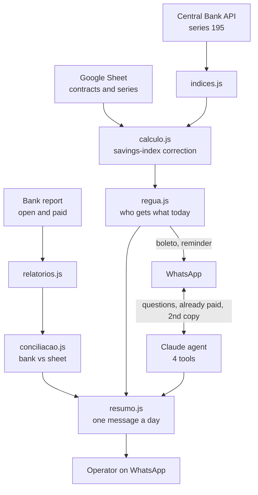

# AI Debt-Collection Agent

[](https://github.com/rodrigomedeiros91-source/agente-cobranca-ia/actions/workflows/tests.yml)

*[Leia em português](README.pt-BR.md)*

A WhatsApp debt-collection agent for companies that sell real estate on installments. It sends each boleto (Brazilian bank slip) at the right time, reminds people who are late, corrects installments by Brazil's savings-rate index, reads the bank's report to find out who paid, and condenses everything that needs a human into one daily summary.

I built it for a real client, a company that sold property in installments and ran collections by hand in a spreadsheet. This public version replaces names, phone numbers, properties and the company with made-up data. The real cases stay in a private repository.

## How it works



## Decisions that matter

| Real problem | Solution |
| --- | --- |
| Collections is the easiest conversation to ruin | Only 4 tools. The agent can't calculate, give discounts, change due dates or confirm payments |
| A rule in the prompt is a suggestion | Guardrails live in code: `reenviar_boleto` refuses on its own a boleto that is no longer valid |
| Customer says "I already paid" | `registrar_pagamento_informado` pauses collection until the next bank report, without claiming the money arrived |
| "Written off" in the bank looked like payment | It isn't: the bank writes boletos off after 60 days unpaid. Reconciliation treats it as open debt |
| Cent differences from rounding | The math reproduces the client's spreadsheet to the cent (in the private project, checked against 17,000 real months) |
| The bank fee was being compounded | The fee stays out of the base: over 24 months the error would cost the customer more than R$ 130 |
| Operator interrupted all day | Everything that needs them becomes one daily summary instead of twenty messages |
| A spreadsheet edited by humans | Columns are read by name, never by position; missing data becomes an alert, not zero |
| Transparency and LGPD (Brazil's GDPR) | Every conversation starts by saying it's an automated assistant and which company it represents |

The schedule, the correction, the report parsing and the reconciliation are pure functions: data and clock in, a list of actions out. That's why the tests cover cases like "Saturday at 8:01 pm" without waiting for Saturday.

## Run

```bash
npm install
cp .env.example .env   # ANTHROPIC_API_KEY, WhatsApp and Google Sheets
npm start
```

Tests (no network, no API key):

```bash
npm test
```

The WhatsApp core (per-contact queue, signed webhook, audio, encrypted state, coexistence with the owner's app) is shared with [agente-whatsapp-ia](https://github.com/rodrigomedeiros91-source/agente-whatsapp-ia).

## Stack

Node.js 18+, Express, Anthropic SDK (Claude tool use), Google Sheets API, Brazilian Central Bank SGS API, WhatsApp Cloud API (Meta) and YCloud, Docker.

## Author

**Rodrigo Medeiros**, AI & automation consultant, Rio de Janeiro. [LinkedIn](https://www.linkedin.com/in/rodrigo-r-244203161/)

Written with AI-assisted development (Claude Code); gathering the business rules with the client, the tests and the architecture decisions are mine. Code comments are in Portuguese, the client's language.
