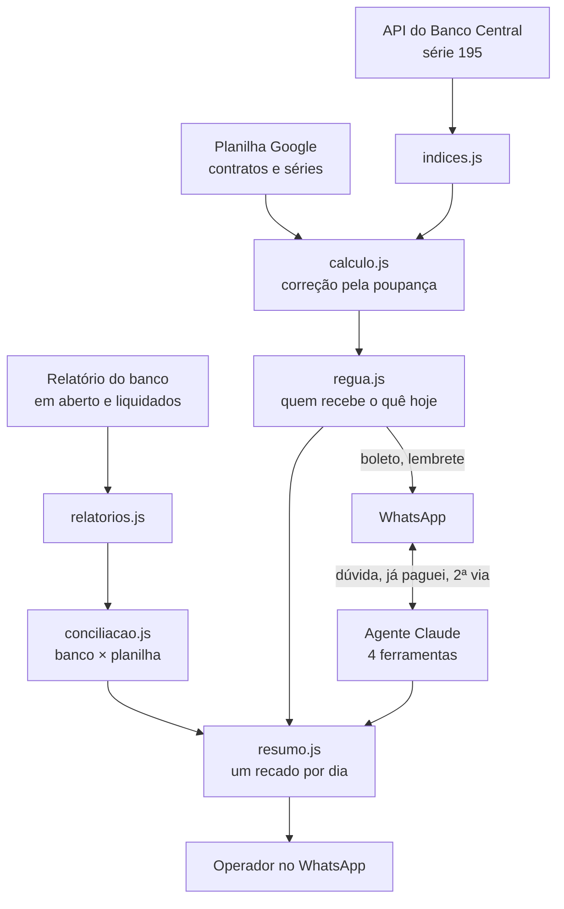

# Agente de cobrança com IA

*[Read in English](README.md)*

Agente de cobrança no WhatsApp para quem vende imóvel a prazo. Ele manda o boleto na hora certa, lembra quem atrasou, corrige a parcela pela poupança, lê o relatório do banco para saber quem pagou e junta num resumo diário só o que precisa da cabeça de uma pessoa.

Criei o projeto para um cliente real, uma empresa que vende imóveis parcelados e cobrava tudo numa planilha, à mão. Esta versão pública troca nomes, telefones, imóveis e a empresa por dados inventados. Os casos reais ficam no repositório privado.

> **English summary:** WhatsApp debt-collection agent built on Claude for a real estate seller with installment contracts. It runs a reminder schedule, recalculates installments with Brazil's savings-rate index (fetched from the Central Bank API), parses the bank's boleto reports to reconcile payments, and condenses everything that needs a human into one daily summary. The model can't give discounts, change due dates or confirm payments: those limits live in the tools, not the prompt. 522 offline test checks.

## Como funciona



## Decisões que fazem diferença

| Problema real | Solução |
| --- | --- |
| Cobrança é a conversa mais fácil de estragar | Só 4 ferramentas. O agente não calcula, não dá desconto, não muda vencimento e não confirma pagamento |
| Regra no prompt é sugestão | As travas moram no código: `reenviar_boleto` recusa sozinho um boleto que não vale mais |
| Cliente diz "já paguei" | `registrar_pagamento_informado` pausa a cobrança até o próximo relatório do banco, sem afirmar que recebeu |
| "Baixado" no banco parecia pagamento | Não é: o banco baixa o boleto sozinho após 60 dias. A conciliação trata baixa como dívida aberta |
| Diferença de centavos no arredondamento | A conta reproduz a planilha do cliente centavo por centavo (no projeto privado, conferida contra 17 mil meses reais) |
| A tarifa do boleto entrava na correção | A tarifa fica fora da base: em 24 meses o erro custaria mais de R$ 130 ao cliente |
| Operador interrompido o dia todo | Tudo que precisa dele vira um resumo diário, em vez de vinte recados |
| Planilha mexida por gente | Tudo é lido pelo nome da coluna, nunca pela posição; dado faltando vira alerta, não zero |
| Transparência e LGPD | Toda conversa começa dizendo que é um assistente automático e de qual empresa |

A régua, a correção, a leitura dos relatórios e a conciliação são funções puras: entram dados e relógio, sai a lista do que fazer. Por isso os testes cobrem casos como "sábado às 20h01" sem esperar o sábado.

## Rodar

```bash
npm install
cp .env.example .env   # ANTHROPIC_API_KEY, WhatsApp e Google Sheets
npm start
```

Testes (sem rede e sem chave de API):

```bash
npm test
```

O núcleo de WhatsApp (fila por contato, webhook assinado, áudio, estado cifrado, coexistência com o app do dono) é o mesmo do [agente-whatsapp-ia](https://github.com/rodrigomedeiros91-source/agente-whatsapp-ia).

## Stack

Node.js 18+, Express, Anthropic SDK (Claude com tool use), Google Sheets API, API SGS do Banco Central, WhatsApp Cloud API (Meta) e YCloud, Docker.

## Autor

**Rodrigo Medeiros**: consultor de IA e automação, Rio de Janeiro. [LinkedIn](https://www.linkedin.com/in/rodrigo-r-244203161/)

Escrito com desenvolvimento assistido por IA (Claude Code), com levantamento das regras junto ao cliente, testes e decisões de arquitetura meus.
